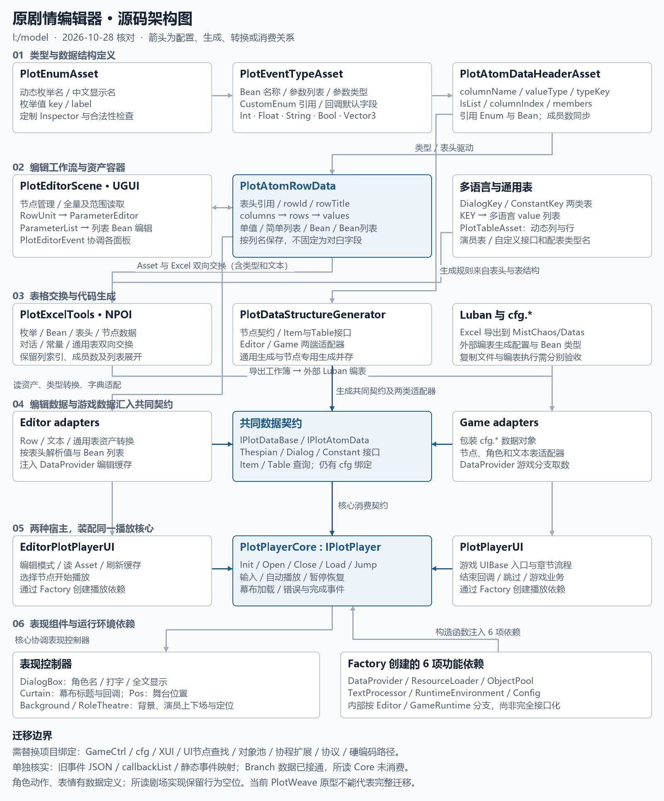
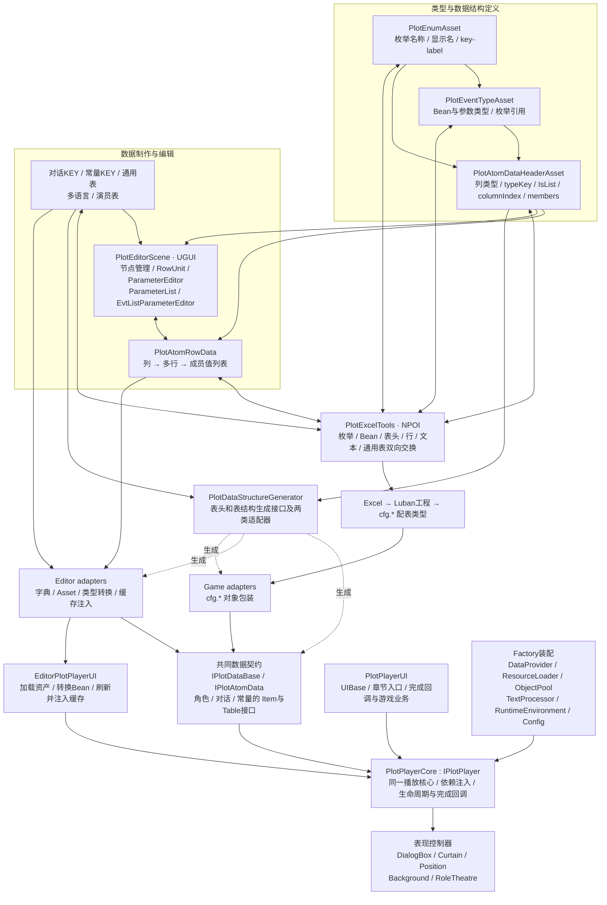
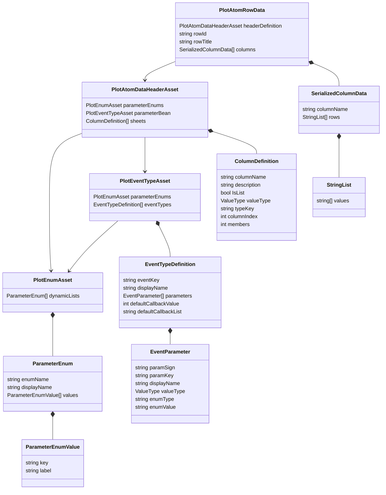
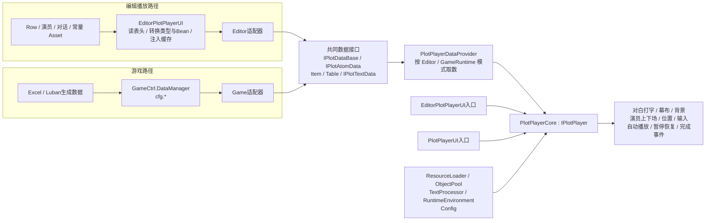

# 原剧情编辑器架构与迁移基线

核对日期：2026-10-28。来源：`I:/model` 的现有源码、类型配置资产，以及场景脚本 GUID 引用。此文描述原实现，不将 PlotWeave 简化原型当作原编辑器的架构。没有以代码行数或文件数换算迁移百分比。

## 总图

箭头表示配置、转换、生成或消费方向，不表示原代码已全部解耦。原 `PlotPlayerDataProvider`、资源加载器等仍在内部根据运行模式分支，使用具体类装配；不能将它们描述成已经完成的纯接口式服务系统。生成接口中的 Bean 仍引用 `cfg`。

## 一、类型系统和可配置数据结构

`ValueType` 实际包含 Int、Float、String、Bool、Vector3、CustomEnum、CustomBean。列表由列上的 `IsList` 表示，Bean 成员数会与参数数量同步。枚举保存 key 与 label，而不是只保存一串展示字符串。

节点并不是固定字段的 `PlotNode`：`PlotAtomRowData.columns` 中每列包含多行，每行包含多个成员值。单值、简单列表、Bean、Bean 列表都建立在这个结构和表头定义上。尚未证明支持任意递归嵌套 Bean，不在图中作此承诺。

现有表头实例有 7 个逻辑列：ScenesID、PlotRoleID、Dialog、Next、*RoleAction、*PlotSetBack、*Branch；后三项是 Bean 列表，分别占 4、2、2 个成员列。导出行为需要保留 `columnIndex`、`members`、星号约束标记、独立的 `IsList` 与多行展开，不能用“JSON 单元格能保存内容”替代。原生成器注释将星号视为Luban约束标记，不应将其直接等同于列表类型。

来源：[枚举](I:/model/Assets/PlotEditor/PlotTypeAseetClasses/PlotEnumAsset.cs:24)、[Bean与参数类型](I:/model/Assets/PlotEditor/PlotTypeAseetClasses/PlotEventTypeAsset.cs:22)、[表头](I:/model/Assets/PlotEditor/PlotTypeAseetClasses/PlotAtomDataHeaderAsset.cs:11)、[行容器](I:/model/Assets/PlotEditor/PlotTypeAseetClasses/PlotAtomRowData.cs:11)、[现有表头配置](I:/model/Assets/PlotEditor/Data/PlotDataAsset/PlotAtomDataHeader.asset)。

## 二、编辑器的真实交互结构

入口为 `Assets/Scenes/PlotEditorScene.unity`，不是新写的 GraphView 窗口。场景中通过脚本 GUID 确认了 `NodeRowDataEditor` 和 `EditorPlotPlayerUI` 的挂载。尚未运行原场景逐个检查按钮，因此这里是源码和序列化引用图，而非原 UI 的视觉复刻证明。

- `PlotEditorManager`：节点创建、加载、重命名、删除、全量与范围读取；资产路径和默认表头读取。
- `PlotEditorEvent`：连接节点列表、当前节点、行编辑、列表面板和播放刷新等事件。
- `PlotNodeView / PlotNodeButton / NodeCreater / NodeListLoader / CurrentNodeEditor`：节点索引、选择和管理。列表依赖 LoopVerticalScrollRect。
- `NodeRowDataEditor → RowUnit → ParameterEditor → Parameter`：依据表头分配编辑单元；根据类型切换普通输入、枚举下拉和 Bean 多参数。
- `ParameterList → EvtListParameterEditor → Parameter`：编辑列表中的多行数据，按 Bean 参数键和中文显示名映射，处理增删、保存和列表回收。
- `DiaLogKeyEditor`：绑定节点的对话 KEY、生成／填入／删除 KEY、修改内容、切换语言和未保存检查；不等同于一个 TextKey 字符串输入框。
- 各 `*AssetEditor`：枚举、Bean、表头、行、文本与通用表的定制 Inspector，带校验、导入导出和代码生成入口。

语言枚举现有 5 项：简体中文、繁体中文、英语、日语、韩语。对话表与常量表分开，按 KEY 保存多语言列表。通用 `PlotTableAsset` 另有列定义、行数据以及自定义接口名与 Luban 类型名配置。

来源：[场景](I:/model/Assets/Scenes/PlotEditorScene.unity:316601)、[节点列表](I:/model/Assets/PlotEditor/PlotComponent/Scripts/PlotNodeView.cs:7)、[行面板](I:/model/Assets/PlotEditor/PlotComponent/Scripts/NodeRowDataEditor.cs:7)、[单值与Bean面板](I:/model/Assets/PlotEditor/PlotComponent/Scripts/ParameterEditor.cs:139)、[列表面板](I:/model/Assets/PlotEditor/PlotComponent/Scripts/ParameterList.cs:109)、[对话KEY编辑器](I:/model/Assets/PlotEditor/PlotComponent/Scripts/DiaLogKeyEditor.cs:8)、[通用表](I:/model/Assets/PlotEditor/PlotTypeAseetClasses/PlotTableAsset.cs:10)。

## 三、同一核心的两条数据与运行路径

`IPlotDataBase` 只有 `IsValid`、`DataSource`；没有假设它包含 ID。`IPlotAtomData` 的数据为 ScenesID、PlotRoleID、Dialog、Next 与三种 Bean 列表。对话与常量生成 Item/Table 两级接口；演员既有 `IPlotThespianData`，又有另一套 `IPlotThespianDataItem/Table`，其中当前生成 Item 接口为空，这个差异不能忽略。

`IPlotPlayer` 实际声明初始化、开关、载入节点、输入、自动播放、暂停恢复、节点跳转、当前／下一节点、幕布加载以及错误／加载／完成事件。`PlotPlayerCore` 在 `PlotPlayerUI_NodeClass.cs`，不能按“文件名像绑定代码”将其整体丢掉。

`PlotPlayerFactory` 创建 6 个功能对象，核心构造函数接收它们。对白、幕布、背景、演员剧场和位置控制器是独立协作对象，不是把表现事件打印为日志就能替代。资源和对象池实现内部仍调用游戏系统；编辑分支使用 AssetDatabase 与编辑器缓存。

来源：[基础接口](I:/model/Assets/HotUpdate/UI/PlotPlayerUI/Generated/Interfaces/IPlotDataBase.cs:11)、[节点与角色契约](I:/model/Assets/HotUpdate/UI/PlotPlayerUI/Generated/Interfaces/IPlotAtomData.cs:13)、[数据提供与运行模式](I:/model/Assets/HotUpdate/UI/PlotPlayerUI/IPlotPlayer.cs:101)、[编辑转换与注入](I:/model/Assets/PlotEditor/PlotComponent/Scripts/EditorPlotPlayerUI.cs:242)、[共用核心](I:/model/Assets/HotUpdate/UI/PlotPlayerUI/PlotPlayerUI_NodeClass.cs:670)、[游戏入口](I:/model/Assets/HotUpdate/UI/PlotPlayerUI/PlotPlayerUI.cs:14)。

## 四、代码生成与 Excel 工具链

`PlotDataStructureGenerator` 包含从表头生成节点结构，以及对话／常量单列表、通用表结构的生成路径。产物不只是一份命令参数接口：包括基础契约、节点数据契约、Item/Table 查询接口，以及 Editor / Game 两类适配器。另有固定节点专用生成分支和通用分支，需要分别建立验收用例，不能以固定七字段生成器代替全部行为。

`PlotExcelTools` 对应 6 类交换内容：动态枚举、Bean、节点表头、节点行、多语言文本、通用表。现有工作簿为 `__plotenums__.xlsx`、`__plotbeans__.xlsx`、剧情基础节点、剧情对话文本、剧情常量文本、剧情资源演员表。NPOI 负责 Excel 操作，`OutputPlotDataToLubanData` 将 Excel 复制到 `MistChaos/Datas`；该方法本身没有执行 Luban 编译，不把“复制成功”当成编表成功。

来源：[结构生成器](I:/model/Assets/PlotEditor/PlotEditorTools/PlotDataStructureGenerator.cs:26)、[单列表与通用表生成](I:/model/Assets/PlotEditor/PlotEditorTools/PlotDataStructureGenerator.cs:92)、[Excel工具](I:/model/Assets/PlotEditor/PlotEditorTools/PlotExcelTools.cs:14)、[复制到Luban工程](I:/model/Assets/PlotEditor/PlotEditorTools/PlotExcelTools.cs:2398)。

## 五、声明、旧实现与当前主链的区别

- `PlotEventJsonData / PlotEventsJsonContainer` 有事件序号、参数、执行顺序、callbackList 以及排序操作；目前在已检查的主目录中未找到主播放路径调用它们。按独立候选模块登记，后续查清用途，不能默认为已经接入的回调调度引擎，也不能未经核实删除。
- `PlotNodeDataBase`、静态事件参数映射、中文枚举映射、旧节点生命周期接口均存在；已检查主路径未证明它们是当前 UGUI 编辑链的入口。它们单独登记，避免把遗留 GraphView 引用误当成正在使用的主编辑器。
- 现有 `Branch` 已进入表头、Bean、转换和接口；所读 `PlotPlayerCore.ProcessPlotData` 未消费 Branch。原系统“有数据结构”与“运行时能点击选项”必须分开验收。
- 角色 `ActionType / Emote` 已有配置和 Bean 字段，但剧场控制器实际执行上下场、定位，代码中保留“角色设置行为目前留空”；不能凭字段声明声称动作、表情演出全已完成。
- 暂停接口的当前实现主要设置输入门禁，没有证明所有协程和动画都会同步暂停。原行为与后续增强分别记录。
- 重复的 Editor/Game 节点适配器同时出现在生成目录和 `IPlotPlayer.cs` 的不同命名空间；迁移时需要明确唯一的生成源与引用，不机械复制两份。

以上是源码检查发现的边界，不是已经执行过原项目运行测试的结论。

## 六、迁移拆分与验收顺序

1. **类型与数据结构**：保留动态枚举 key/label、Bean 参数定义、表头配置、多行多成员行容器、多语言文本、通用表；先用新建复杂样例做序列化与校验，不能只测试四节点对话。
2. **数据契约与适配器生成**：恢复节点、Item/Table、Editor/Game 两端生成路径；将 `cfg` 类型绑定做成可配置输出或独立适配层。证明两端提供一致数据，核心不依赖游戏全局单例。
3. **编辑器使用方式**：恢复节点管理、表头驱动的参数面板、列表 Bean 编辑、KEY 编辑、多语言与刷新播放。UGUI 原工作流有明确迁移位置后，才评估是否另加图形视图。
4. **Excel与编表链路**：逐类检验 Asset↔原格式工作簿的语义往返，覆盖多成员、列表展开和枚举、文本。Luban 工具配置、代码生成、数据加载分别验证；不强制换成简化 JSON 格式。
5. **同一播放核心与两套宿主**：保留生命周期、注入依赖、对白、幕布、背景、剧场、位置、对象池、文本与资源加载。替换 XUI、GameCtrl、协议和硬编码路径；用新资源搭建编辑场景和游戏播放场景。
6. **功能对应验收**：每条原能力有源文件、目标模块和验收证据。原来未接通的功能明确标记，增强项另列，不用新项目测试通过冒充迁移完成。

当前 `com.plotweave.core` 仅为基础验证原型。15 项测试和 Windows 构建证明的是这个原型自身的行为，没有覆盖上述完整原工具链，不能代表完整迁移已完成。
