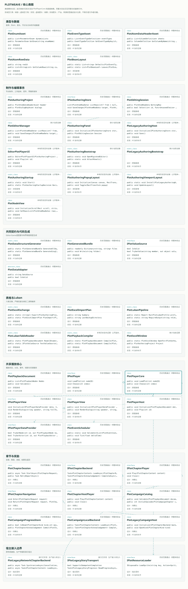

# PlotWeave · 织幕

面向 Unity 的剧情制作、数据交换与播放工具。通过类型与表头描述作者数据，将节点资产、文本表、Excel 和游戏侧读口连接起来；Asset、JSON 与 Luban 数据最终使用同一套播放核心。

[首次运行](Doc/公开版首次运行.md) · [核心类图](Doc/Review/class-diagram.svg) · [设计来源与状态](Doc/Review/设计来源与状态说明.md) · [AI 工程导航](AI_CONTEXT.md) · [MIT 许可证](LICENSE)



## 可以看什么

- **数据建模**：动态枚举、嵌套 Bean、表头、多行节点资产及多语言文本。嵌套类型显式绑定，循环和缺失类型明确报错。
- **制作工具**：UGUI 节点录入、参数与列表编辑、工作副本、保存、草稿恢复、未保存输入试跑，以及绑定当前工作区的表格交换入口。
- **双端接口与生成**：共同契约、Editor/Game 适配器和有界嵌套类型生成，减少作者数据与游戏读口各写一份的负担。
- **数据互转**：作者资产与六份 XLSX 交换，保留行身份、列顺序和显式空列表；可选接入 Luban 4 生成游戏数据。
- **共享播放核心**：对白、分支、事件、暂停与取消，视图、资源加载、对象池及环境服务通过接口接入。
- **章节与业务边界**：章节浏览、解锁、进度、首次奖励及重看；生产网络与道具数据留给宿主实现。

```text
类型 / 表头 → 作者资产与编辑事务 → 播放快照 → PlotPlayerCore → Unity 视图与宿主
                      ↕
                  六表 XLSX → 可选 Luban 编译 → 游戏数据适配器
```

新增数据字段不会自动获得新的播放语义：业务表现需要映射到标准播放节点，或通过事件与宿主服务实现。

## 开始体验

本次开发与验证使用 **Unity 2022.3.62f3c1**。建议用相同版本打开仓库根目录，等待 Package Manager 解析与脚本编译；其他 Unity 版本尚未验证。

1. 执行 `Tools / PlotWeave / 打开剧情编辑器`。公开版使用通用 UGUI 制作工作区，自动进入 Play Mode。可以录入节点、编辑参数与文本、点击“试跑当前输入”、保存及打开表格互转。
2. 打开 `Assets/PlotWeaveMigration/Stage18_CampaignReference/CampaignReference.unity` 并进入 Play Mode，体验完全合成的章节、分支、奖励与跳过流程。
3. 查看 `Stage08_Advanced/BranchAndEvents.unity`、`Stage10_Chapters/ChapterHost.unity` 等示例，分别阅读播放与业务接入方式。

通用制作页可直接试跑尚未保存的当前工作副本，使用独立全屏预览。历史原布局使用制作页内嵌预览，两者共用播放核心；原布局与原内容不随公开仓库分发。

核心录入及 Asset 播放不需要 Luban 编译器。需要重新生成 Luban 二进制时，按[首次运行说明](Doc/公开版首次运行.md)安装 **.NET 8** 与 **Luban v4.10.2**；仓库不附带外部编译器 DLL。

## 给评审者

浏览器离线打开 [Doc/Review/index.html](Doc/Review/index.html)，可按模块查看精选类型、真实成员、关系和实现边界。GitHub 文件预览不会执行这个 HTML，请先克隆或下载工程。静态阅读可直接查看上面的 SVG 类图。

面向 AI 或脚本，先读 [AI_CONTEXT.md](AI_CONTEXT.md)，再使用结构化索引定位源码：

```sh
python -X utf8 Tools/Review/query.py summary
python -X utf8 Tools/Review/query.py find PlotPlayer
python -X utf8 Tools/Review/query.py show PlotPlayerCore
python -X utf8 Tools/Review/query.py module exchange
```

查询仅读取本地文件，不启动 Unity。`verify` 比较索引和源码摘要，不会运行测试。

## 验证与待完善内容

[公开版本检查记录](Doc/Records/PublicExport/verification.json)单独记录本次公开副本的检查范围。阶段档案中的 **277 项历史测试**及**最近 40 项定向测试**来自本地迁移工程，包含未分发的本地输入；它们不代表公开克隆已经重新通过全量测试或移动端验收。

优先待完善的设计问题见[设计审查](Doc/Review/设计审查_2026-10-29.md)：旧草稿恢复的冲突保护、节点跳转引用完整性，以及高频草稿写入的开销。生产 Transport、原道具库和区域权限仍需宿主注入。Android/iOS 真机未验收，iOS 构建未验证。

这是从既有工具设计演进出的独立实现，当前迁移、重写与补齐过程使用了 AI 协作。原设计脉络与当前实现分别记录在[来源说明](Doc/Review/设计来源与状态说明.md)，不将整体贡献自述换算成逐类或逐行作者比例。

## 许可与内容范围

PlotWeave 自有代码采用 **MIT**，Copyright © 2026 CodeV。第三方字体、Luban 运行库模板及 Unity 资源保留各自许可，详见 [THIRD_PARTY_NOTICES.md](THIRD_PARTY_NOTICES.md)。

仓库包含通用代码与合成示例，不包含原项目剧情、美术、本地重建布局截图、Unity 缓存或构建产物。[公开内容边界](Doc/本地数据与公开候选边界.md)保留迁移阶段的范围说明。
